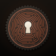
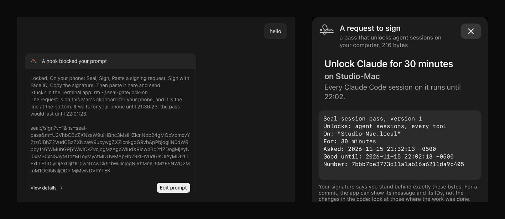
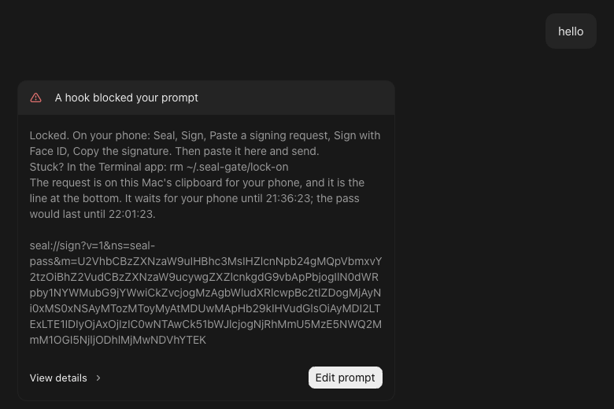
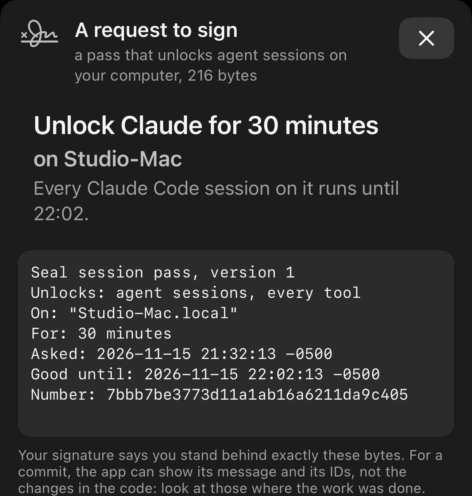
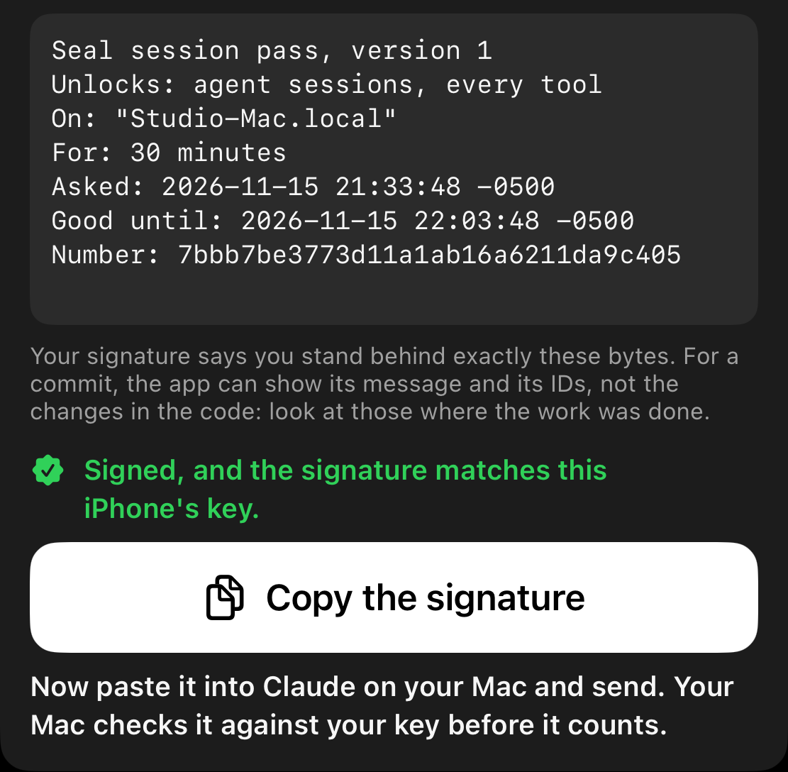
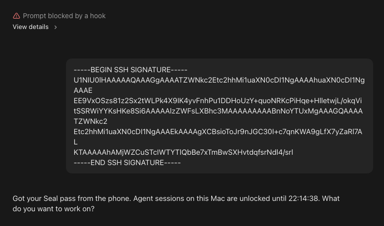
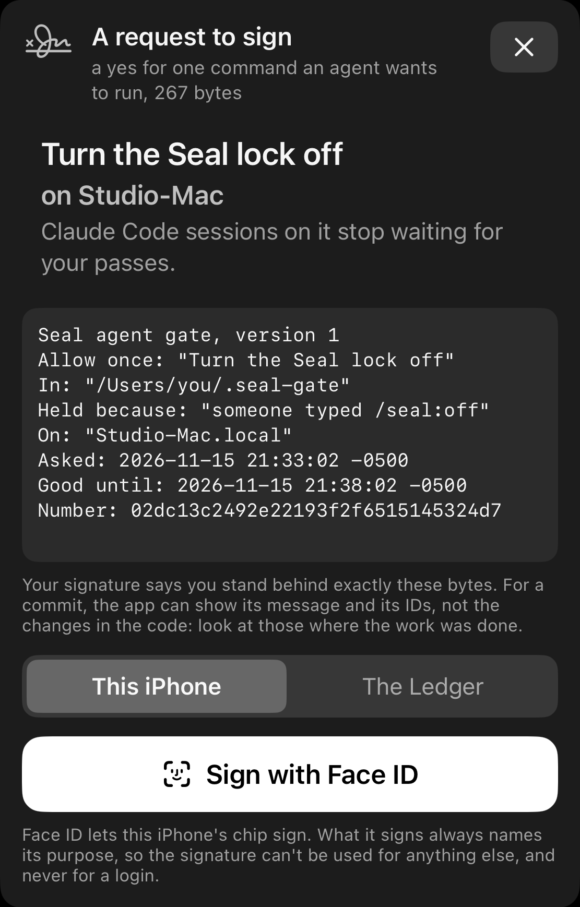

<div align="center">



</div>

<div align="center">



</div>

<h1 align="center">Seal for Mac</h1>

<p align="center">
  <b>Your Claude Code sessions wait for your phone.</b><br>
  Turn the lock on, and no session on your Mac takes a message or runs a tool until your iPhone signs a pass with Face ID.
</p>

<div align="center">

   [](LICENSE)

</div>

I let AI agents work on my Mac all day, and anyone who gets into my Mac or my account can talk to them too. So I put my phone in the way. The key that opens the lock lives in the iPhone's security chip and only signs after Face ID, so nothing on the Mac can open it by itself: not a script, not an agent, not someone with a stolen login.

This is the Mac side of [Seal](https://redthoroughbred.github.io/seal), an iPhone app that turns the phone into a security key.

## Install

In Claude Code, type:

```
/plugin install seal --marketplace RedThoroughbred/seal-mac
```

In the Claude desktop app, `/plugin` opens the app's own plugin settings instead, so run this in a terminal:

```
claude plugin install seal --marketplace RedThoroughbred/seal-mac
```

In a session that's already open, run `/reload-plugins`. Nothing is locked until you type `/seal:on`.

## What you need

- **Seal on your iPhone,** with the iPhone's own key made. Seal is coming to the App Store; [its site](https://redthoroughbred.github.io/seal) has the guides.
- **A Mac with Claude Code** 2.1.295 or later, and Apple's Python 3 at `/usr/bin/python3` (it comes with the Command Line Tools).
- **Handoff on, on both.** The phone and the Mac pass the request and the signature over Apple's shared clipboard: the same Apple Account, Wi-Fi and Bluetooth on, the phone near the Mac. iPhone: Settings, General, AirPlay & Continuity. Mac: System Settings, General, AirDrop & Handoff. To check, copy a word on the phone and press ⌘V on the Mac.

## A tour

### Pair your phone, then lock

On the phone: Seal, **Sign**, `Copy SSH key`. In Claude Code: `/seal:pair`. The Mac now trusts that one public key and nothing else. Then `/seal:on`: every Claude Code session on the Mac waits for a pass, the one you typed it in too.

### Your message is held

Claude shows what to do right under it, and the way out if you're ever stuck. The request is already on the Mac's clipboard, on its way to your phone.



### Your phone shows exactly what it signs

In Seal: **Sign**, `Paste a signing request`. It names the Mac and when the pass ends, in large words above the exact bytes the key will sign. A pass lasts 30 minutes unless you ask for longer, four hours at most.



### Face ID, then copy the signature

`Sign with Face ID`, then `Copy the signature`. The phone checks its own signature before it lets you copy it, and says where it goes next.



### Paste it, and you're in

⌘V in Claude's message box fetches the signature from the phone at that moment. Send it, and every session on the Mac runs until the pass ends. Away from the Mac, paste it into the Claude app on your phone through Remote Control: it works the same.



### Turning it off takes your phone too

`/seal:off` asks the phone for a yes to exactly that, so nothing on the Mac can switch the lock off alone. Sign it, paste it, send.



### The commands

| Command | What it does |
|---|---|
| `/seal:status` | Where the lock stands, the paired key, the pass |
| `/seal:pair` | Trust the phone's key (copied on the phone: Sign, `Copy SSH key`) |
| `/seal:on` | Lock every Claude Code session on this Mac |
| `/seal:pass 120` | Ask for a longer pass (four hours at most) |
| `/seal:drop` | Done for now? Ends your pass early, so everything is held again |
| `/seal:off` | Turn the lock off, with a yes from your phone |
| `/seal:git` | Sign this repository's git commits with your phone |
| `/seal:lockdown` | Make the lock hold against any project's settings (one step in Terminal, with your Mac's password) |

While you're locked, `/seal:status`, `/seal:on`, `/seal:drop` and `/seal:lockdown` still go through. Claude can't run any of these commands itself.

**Stuck?** In the Terminal app (not Claude Code): `rm ~/.seal-gate/lock-on` turns the lock off. Whoever sits at your Mac can always do this: the lock keeps your agents from being driven from elsewhere, not your Mac from you.

## How it works

- The plugin puts two hooks in front of Claude Code: one before every message, one before every tool. While the lock is off they exit at once, without starting Python.
- While it's on, `bin/seal-gate` looks for a pass: your phone's signature over words that name this Mac and the time the pass ends. The Mac's own `ssh-keygen` checks it against your phone's public key at every message and every tool call.
- The private key never leaves the iPhone's Secure Enclave and signs only after Face ID. A pass, a yes to turning the lock off and a git commit are signed for different purposes, so one never counts as another.
- If the lock breaks or can't start, it holds (`"onFailure": "block"`).
- `/seal:lockdown` moves the hooks into Claude Code's admin-owned settings, where no project, local or user setting can switch them off.

[The details](docs/details.md) cover lockdown, git signing, a lost phone, and plainly what the lock holds and what it doesn't.

> [!IMPORTANT]
> A pass opens every Claude Code session on the Mac for its length, not only yours. Keep passes short, and `/seal:drop` when you step away.

## What it runs and sends

- **Programs it starts:** on every message and tool call, `/bin/sh bin/seal-hook`. While the lock is on, it runs `/usr/bin/python3 -I bin/seal-gate hook` with an empty environment, which runs `/usr/bin/ssh-keygen` to check signatures and `/usr/bin/pbcopy` and `/usr/bin/pbpaste` for the clipboard. For git signing, `bin/seal-git-sign` runs `git`, `ssh-keygen` and `/usr/bin/osascript` (a notice on the Mac when an agent's commit waits for your phone). `bin/seal-lockdown` runs only when you run it yourself with `sudo`.
- **The clipboard:** while you're locked, the lock reads the Mac's clipboard looking for your phone's signature, and puts a request line on it when it asks for a pass. It never writes over a signature it hasn't used yet.
- **Files it writes:** `~/.seal-gate` (the switch, your phone's public key, the pass and waiting requests); `~/.seal-sign` (git signing requests); for `/seal:git`, four settings in that repository's own `.git/config` and a `seal-allowed-signers` file in `.git`; with lockdown, root-owned copies in `/Library/Application Support/Seal` and two hooks in `/Library/Application Support/ClaudeCode/managed-settings.json`.
- **Network:** none. It opens no port and sends nothing to any server. The signature travels by Apple's clipboard or by your paste.
- **Environment:** the hooks take nothing from it. The home folder comes from the system's user list, and Python runs in isolated mode.

## Tests

```
python3 -m unittest discover -s tests -v
```

They run the real tools and the real `ssh-keygen` with a stand-in phone key and a pretend clipboard, in a temporary folder: your `~/.seal-gate` and clipboard are never touched.

I built it with Claude Code as my coding partner.

## License

MIT. See [LICENSE](LICENSE). Seal's iPhone app is a separate product. An independent project, not affiliated with Anthropic or Apple.
