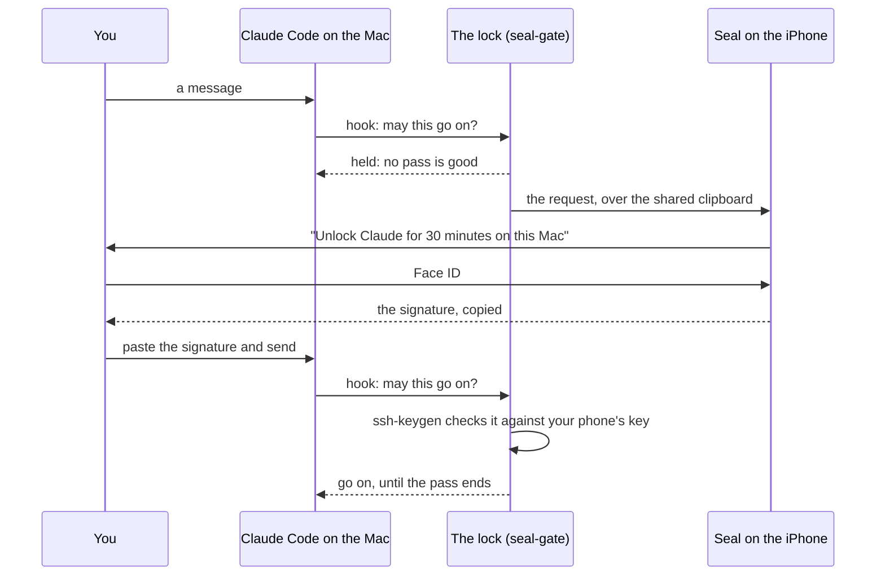

# Seal for Mac: the details

The [README](../README.md) is the tour. This page has the rest: every command, lockdown, a lost phone, git signing, and plainly what the lock holds and what it doesn't.

- [The loop](#the-loop)
- [Install](#install)
- [Pair your phone (once)](#pair-your-phone-once)
- [Lock your sessions](#lock-your-sessions)
- [Lock it down](#lock-it-down)
- [Lost your phone?](#lost-your-phone)
- [Sign git commits](#sign-git-commits)
- [What it holds and what it doesn't](#what-it-holds-and-what-it-doesnt)
- [Without the plugin](#without-the-plugin)

## The loop



The Mac never sees the private key. It holds only the phone's public key, and a pass counts only if that key signed the exact words the Mac asked for: this Mac's name, how long, when it was asked, when it ends and a one-time number.

## Install

```
/plugin install seal --marketplace RedThoroughbred/seal-mac
```

or, in a terminal (in the Claude desktop app, `/plugin` opens the app's own settings):

```
claude plugin install seal --marketplace RedThoroughbred/seal-mac
```

You need Seal on your iPhone, a Mac with Claude Code 2.1.295 or later, and Apple's Python 3 at `/usr/bin/python3`. The phone and the Mac hand the request and the answer over Apple's shared clipboard, so **Handoff has to be on, on both**: the same Apple Account, Wi-Fi and Bluetooth on, the phone near the Mac. iPhone: Settings, General, AirPlay & Continuity, Handoff. Mac: System Settings, General, AirDrop & Handoff. To check: copy a word on the phone, press ⌘V on the Mac, and the word should appear.

## Pair your phone (once)

1. On the phone: Seal, **Sign** page, `Copy SSH key`.
2. In Claude Code: `/seal:pair`

The Mac now trusts that one key, and only it.

## Lock your sessions

```
/seal:on
```

From your next message, every Claude Code session on this Mac (the one you typed it in too) takes no message and runs no tool until your phone signs a **pass**:

1. Your message is held. Claude shows the steps right under it, starting *"Locked. On your phone: …"*, and the request is put on the Mac's clipboard.
2. On the phone: **Sign**, `Paste a signing request`. It names your Mac and when the pass ends. `Sign with Face ID`, `Copy the signature`.
3. On the Mac: ⌘V into Claude's message box (that paste fetches the signature from the phone) and send. The pass is good for 30 minutes, for every session on this Mac.

If ⌘V gives you the request back instead, the phone's copy didn't reach the Mac: check Handoff, or paste the signature from the phone through Remote Control. The lock also looks on the Mac's clipboard whenever a message comes in, so sending again can work too.

**Stuck?** Every held message ends with the way out: in the Terminal app (not Claude Code), `rm ~/.seal-gate/lock-on` turns the lock off.

| Command | What it does |
| --- | --- |
| `/seal:status` | Whether the lock is on, whether a pass is good and until when, which phone key is paired |
| `/seal:pass 120` | Ask for a longer pass now (30 minutes unless you say, 4 hours at most) |
| `/seal:drop` | Done for now? Ends your pass early, so everything is held again (with no pass good it changes nothing, and a request waiting for your phone keeps waiting) |
| `/seal:off` | Turn the lock off. **This needs your phone too**: a yes signed for exactly "Turn the Seal lock off" |
| `/seal:pair` | Pair a phone. Refused while the lock is on |
| `/seal:git` | Sign this repository's commits with your phone |
| `/seal:lockdown` | Make the lock hold against any project's settings (one step in Terminal, with your Mac's password) |

While a session is locked, `/seal:status`, `/seal:on`, `/seal:drop` and `/seal:lockdown` still go through, typed alone. None of them opens anything or touches the clipboard. `/seal:off` and `/seal:pass` wait for a pass like any message, so nobody who can't sign can swap the request you are about to sign. Claude can't run any of these commands itself, and they ignore whatever a session or a project sets in the environment.

**Away from the Mac,** with Remote Control on your phone: the held message shows the request as one `seal://sign?…` line. Copy it into Seal, sign, and paste the signature into your next message. That works for a pass, and for `/seal:off` once a pass is good. It also works at the Mac when the shared clipboard doesn't.

## Lock it down

`/seal:on` is a switch in your own files, so a project's Claude Code settings (or an agent that has a pass) can switch it off. **Lockdown** puts the lock in Claude Code's admin-owned settings instead:

```
/seal:lockdown
```

It shows one `sudo` command to paste in the Terminal app. That command shows your phone key's fingerprint, asks you to type yes, and then:

- copies the lock and your phone's public key into `/Library/Application Support/Seal`, owned by root;
- adds two hooks to `/Library/Application Support/ClaudeCode/managed-settings.json`, keeping anything else in that file.

From then on, every Claude Code session on this Mac waits for a pass, no project, local or user setting can switch it off (Claude Code's own rule for admin-owned hooks), and removing it or pairing another phone takes your Mac's password, which no agent has. The hook runs with an empty environment and Python in isolated mode, without a shell, so nothing a session or a project sets reaches it.

Before you type yes, the command shows the SHA-256 of the two files it installs; each release lists them, so you can check. From then on, removing it, pairing another phone and checking it (`/seal:off`, `/seal:pair`, `/seal:status`) use the root-owned copies, never the plugin's folder, which your user can change.

Scheduled jobs that run Claude (a nightly check, an Agent SDK job) wait for a pass too.

## Lost your phone?

If the lock is on and the phone's key is gone (a lost phone, or Face ID set up again, which ends the key on purpose), turn the lock off from the Mac's own Terminal, not from Claude Code:

```
rm ~/.seal-gate/lock-on
```

Then pair the new key: in Seal, **Sign** page, `Copy SSH key`, and `/seal:pair`. Whoever sits at your Mac can always do this; the lock keeps your agents from being driven from elsewhere, not your Mac from you.

## Sign git commits

Inside a repository: `/seal:git`. Then `git commit -S`, or `git config commit.gpgsign true` to sign every commit there.

When git wants a signature, the request goes on the clipboard (with a notice on the Mac when an agent ran git). Sign it on the phone and `Copy the signature`: git picks it up from the clipboard, checks it with `ssh-keygen` against your key, and only then signs. In a terminal you can also paste it. Add the same key to GitHub as a **Signing Key** and the commits show as Verified.

## What it holds and what it doesn't

- It holds messages and tool calls in every Claude Code session that loads your settings, the one you're in included.
- While a pass is good, sessions work as usual, with Claude's own permission questions.
- A pass, a yes to one command, a commit signature and a yes to turning the lock off are four different purposes. A signature made for one never counts as another, and a yes counts once.
- If the lock breaks or can't start while it's on, it holds (`"onFailure": "block"`). While it's off, it doesn't start Python at all.
- Without lockdown, the switch and the key live in your own files (`~/.seal-gate`): while a pass is good, an agent determined to remove the lock could, and a project's settings could switch the plugin off. With lockdown, neither can.

> [!IMPORTANT]
> **A pass opens every Claude Code session on the Mac for its length, not only yours.** If someone else is driving a session at the same time (a stolen login, a remote control you don't know about), it runs too, and with tools it could leave something behind that runs later: its own hook in your settings, a program of its own. The lock holds Claude Code sessions, not every program on the Mac. Keep passes short, and `/seal:drop` when you're done.

- A command typed with `!` at the Mac's own keyboard runs without hooks. Whoever sits at your keyboard can open Terminal anyway; from the phone, a `!` line arrives as a plain message, and is held.
- Without lockdown, a session started with your settings left out (`claude --setting-sources ""`) isn't under the lock. That is how a scheduled job stays out of it. The lock keeps your agents from being driven by someone else; it doesn't stop someone who can already run commands on your Mac.
- It talks to no network. Signatures are checked by the Mac's own `ssh-keygen`.

## Without the plugin

The tools in `bin/` also run by hand: `bin/seal-gate --help` and `bin/seal-git-sign --help`. To lock one session only: `claude --settings "$(bin/seal-gate settings)"`.

## Tests

```
python3 -m unittest discover -s tests -v
```

They run the real tools and the real `ssh-keygen` with a stand-in phone key and a pretend clipboard, in a temporary folder: your `~/.seal-gate` and clipboard are never touched.

## License

MIT. Seal's iPhone app is a separate, closed product.
